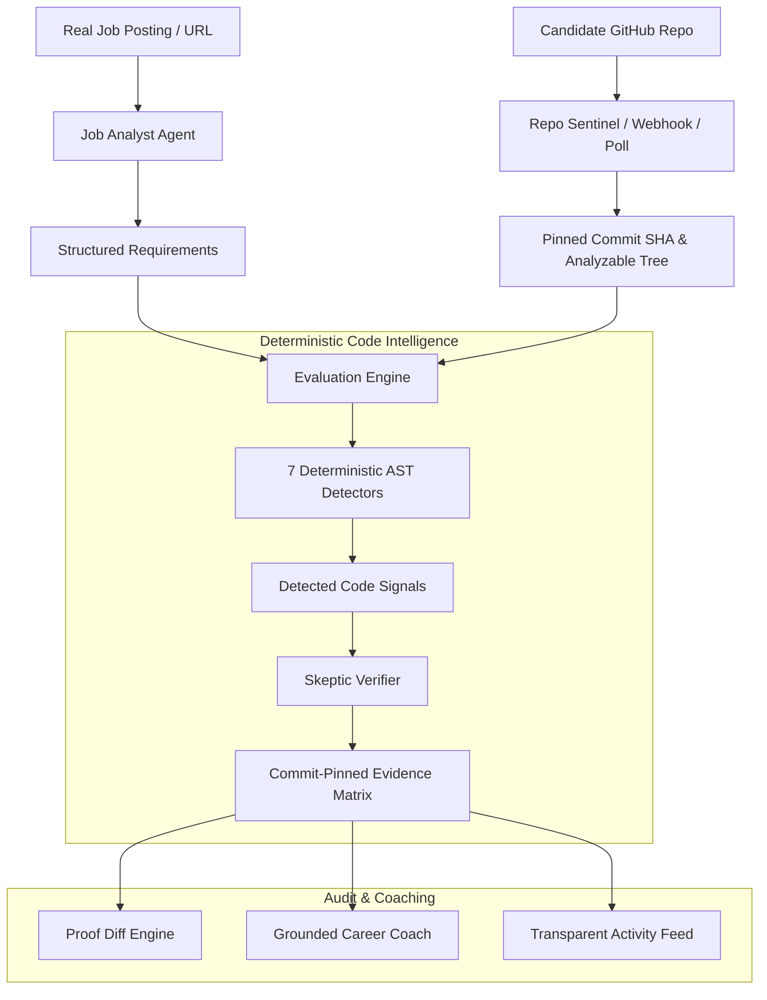

# DevProof ⚡
> **Resumes claim. Repositories prove. DevProof keeps the proof current.**  
> *Evidence-Backed Student Career Intelligence & Continuous Developer Assessment*  
> Worcflow Agentic AI Track · **Problem Statement W-PS-2: AI Career Coach**

---

## 🌟 What is DevProof?

**DevProof** is a continuously updated, evidence-backed developer assessment platform designed for engineering students and early-career developers. Rather than relying on static resumes or opaque readiness percentages, DevProof:

1. **Ingests Real Job Postings:** Parses raw job descriptions or public postings into standardized technical requirements with priority weighting (`must-have` vs `nice-to-have`).
2. **Inspects Real Public Repositories:** Connects to candidate GitHub repositories, checks rate limits, traverses the Git tree, and pins the exact 40-character commit SHA.
3. **Applies Deterministic AST Detectors:** 7 specialized code detectors inspect actual syntax trees (FastAPI/Flask endpoints, SQLAlchemy/PostgreSQL models, Pytest suites, JWT auth, Celery/asyncio concurrency, Docker/CI pipelines) without ever executing repository code.
4. **Verifies Evidence with a Skeptic Verifier:** An independent verification agent matches every detected citation against the exact file lines at the pinned commit, immune to prompt injection or hallucinated line numbers.
5. **Triggers Targeted Reassessment on Push:** A dual background watcher (HTTP push webhooks with HMAC SHA-256 verification and a lightweight 20s polling sentinel) re-evaluates *only* the skills impacted by new commits.
6. **Delivers Grounded Career Coaching:** Generates actionable, commit-pinned roadmaps explaining exactly what was proven, what remains unproven, and how to close engineering gaps.

---

## 🏗️ Architecture & Multi-Agent Data Flow



### The Multi-Agent Pipeline
| Agent | Responsibility | Invariant Enforced |
|---|---|---|
| **Job Analyst** | Extracts job requirements from text or URL with priority | Strict regex & taxonomy fallback; zero hallucinated skills |
| **Repo Sentinel** | Resolves default branch, pins commit SHA, polls & catches webhooks | Immutable historical anchor; duplicate delivery deduplication |
| **AST Detectors** | Parses Python AST for endpoints, schemas, queries, and tests | Static analysis only; **strictly zero code execution** |
| **Skeptic Verifier** | Verifies signal spans against real file lines at pinned commit | Weak-signal immunity (`assert True` / comments earn 0 credit) |
| **Evaluator Engine** | Assigns requirement status (`DEMONSTRATED`, `PARTIAL`, etc.) | Assessment failures become `UNABLE_TO_ASSESS`, never skill gaps |
| **Diff Engine** | Computes before/after proof changes between arbitrary runs | Tracks newly demonstrated, lost, or retained skills |
| **Grounded Coach** | Produces step-by-step career advice grounded in evidence | Distinguishes proven capabilities from missing proof |

---

## 🚦 Evidence Status Enums & Decision Rules

DevProof rejects opaque scores (e.g. *"78% Ready"*). Every requirement is assigned one of four contract statuses based on verifiable evidence:

| Status | Meaning | Decision Rule |
|---|---|---|
| `DEMONSTRATED` | Skill is proven in candidate's code | At least 1 `strong` verified signal or 2+ `medium` verified signals. |
| `PARTIAL` | Emerging evidence present | 1 `medium` or `weak` signal verified (e.g., test structure without assertions, partial router). |
| `NOT_DEMONSTRATED` | No evidence found in analyzed scope | Candidate repository does not contain matching AST patterns within analyzed files. |
| `UNABLE_TO_ASSESS` | Analysis was prevented or skipped | File size exceeded limit, network timeout, rate limited, or private repo. **Never penalized as a skill gap.** |

> ⚠️ **Core Invariant:** *"Not demonstrated in analyzed scope" does NOT equal "student lacks the skill."* DevProof clearly reports what was analyzed and what was out of scope.

---

## 💻 Quickstart & Reproducible Setup

### System Prerequisites
- **Python:** Version 3.11 or higher (Python 3.14 verified)
- **Node.js:** Version 18 or higher (Node 24 / npm 11 verified)
- **Git:** Version 2.40 or higher

---

### Step 1: Clone the Repository
```bash
git clone https://github.com/sranjit29794-bit/Kurukshetra-Career-Agent.git
cd Kurukshetra-Career-Agent
```

---

### Step 2: Configure Environment Variables
Copy the placeholder environment template:
```bash
# Windows (PowerShell):
Copy-Item .env.example .env

# macOS / Linux:
cp .env.example .env
```

Open `.env` in your editor. Set your credentials:
```ini
# GitHub Configuration (Recommended for 5,000 req/h rate limit)
GITHUB_TOKEN=ghp_yourPersonalAccessTokenHere
GITHUB_WEBHOOK_SECRET=your-secure-webhook-secret

# LLM Configuration (Optional - DevProof runs 100% deterministically without it)
LLM_ENABLED=false
LLM_API_KEY=
LLM_BASE_URL=
LLM_MODEL=

# Application & Polling Watcher
DATABASE_URL=sqlite:///./devproof.db
POLL_INTERVAL_S=20
MAX_FILES_ANALYZED=150
MAX_FILE_BYTES=100000
CORS_ORIGINS=http://localhost:5173,http://127.0.0.1:5173
```

*(Note: If `GITHUB_TOKEN` is left empty, DevProof runs in unauthenticated mode capped at GitHub's 60 req/h IP quota).*

---

### Step 3: Backend Setup & Execution

#### On Windows (PowerShell):
```powershell
# 1. Create Python virtual environment
python -m venv .venv

# 2. Activate virtual environment
.\.venv\Scripts\Activate.ps1

# 3. Install backend dependencies
python -m pip install --upgrade pip
pip install -r backend/requirements.txt

# 4. Run the full pytest test suite (75 tests)
python -m pytest

# 5. Launch FastAPI backend server
python -m uvicorn backend.app.main:app --host 127.0.0.1 --port 8000 --reload
```

#### On macOS / Linux:
```bash
# 1. Create Python virtual environment
python3 -m venv .venv

# 2. Activate virtual environment
source .venv/bin/activate

# 3. Install backend dependencies
python -m pip install --upgrade pip
pip install -r backend/requirements.txt

# 4. Run the full pytest test suite (75 tests)
python -m pytest

# 5. Launch FastAPI backend server
uvicorn backend.app.main:app --host 127.0.0.1 --port 8000 --reload
```

The backend server starts on **`http://127.0.0.1:8000`**.  
Verify health: [http://127.0.0.1:8000/api/health](http://127.0.0.1:8000/api/health)

---

### Step 4: Frontend Setup & Execution

Open a second terminal window:

```bash
cd frontend

# 1. Install dependencies
npm install

# 2. Run static linter
npm run lint

# 3. Verify production TypeScript build
npm run build

# 4. Start Vite development server
npm run dev -- --host 127.0.0.1 --port 5173
```

The frontend application starts on **`http://127.0.0.1:5173`**.

---

## 🧪 Verification & Test Commands

| Component | Command | Expected Result |
|---|---|---|
| **Backend Test Suite** | `python -m pytest` | **75 passed** (100% pass rate in ~4.4s) |
| **Phase 9 Resilience Suite** | `python -m pytest backend/tests/test_phase9_resilience_and_adversarial.py` | **20 passed** (SSRF, 401 token, bounds, verifier) |
| **Frontend Linter** | `npm run lint` (in `frontend/`) | **0 warnings, 0 errors** across 13 files |
| **Frontend Production Build** | `npm run build` (in `frontend/`) | Built in <1.5s with zero TypeScript errors |
| **Safe Health Audit** | `GET http://127.0.0.1:8000/api/health/audit` | Returns JSON status; **never leaks secrets or tokens** |

---

## 🎬 5-Minute Evaluator & Judge Demo Script

Follow this reproducible flow to experience DevProof end-to-end:

### Step 1: Open the Application
Navigate to [http://127.0.0.1:5173](http://127.0.0.1:5173). Observe the modern student dashboard with the Candidate Profile badge, active proof tracks, and the live Watcher indicator.

### Step 2: Create a Career Track (`/track`)
1. Click **"+ New Career Track"**.
2. **Step 1 (Job Description):** Choose **"Direct Text Input"** and paste this standard backend engineer requirement:
   > *"Seeking a Senior Python Backend Engineer. Requirements: Build high-performance REST APIs with FastAPI, execute complex SQL queries with PostgreSQL, maintain automated unit test suites with pytest, and package applications in Docker."*
3. Click **"Parse Engineering Requirements →"**.
4. **Step 2 (Review Requirements):** Inspect the extracted requirements mapped into categories (`REST API Development`, `SQL Database Management`, `Unit & Integration Testing`, `Container Deployment`). Click **"Confirm Requirements & Proceed to Repo Connection →"**.

### Step 3: Connect a Public Repository
1. In the repository URL input, connect any real public GitHub repository:
   - To test truthful negative handling on a minimal repository: `https://github.com/octocat/Hello-World`
   - To test positive AST signals on a real Python codebase: `https://github.com/itsharshdev/newdevproof` or `https://github.com/pallets/flask`
2. Click **"Connect & Pin SHA"**.
3. **Observe the result:** DevProof queries the GitHub REST API, pins the exact 40-character commit SHA, bounds and prioritizes analyzable Python files, and displays live rate limit status.
4. Click **"Save & Launch Track Pipeline →"**.

### Step 4: Inspect Commit-Pinned Evidence (`/tracks/:id`)
1. View the **Evidence Matrix**:
   - For minimal repositories (`octocat/Hello-World`), requirements are honestly marked `NOT_DEMONSTRATED` with clear scope caveats (*"Evidence was not detected in inspected scope; this does not indicate candidate lack of skill"*). DevProof never hallucinates credit where code does not exist.
   - For Python repositories, click **"View Verified Citations"** on demonstrated requirements to expand AST-verified source snippets, line spans (`L#-L#`), detector labels, and direct commit-blob links to GitHub.
2. Inspect the **Grounded Coaching** tab to see concrete implementation guides and effort estimates for unverified requirements.

### Step 5: Test the Reassessment & Diff Engine (`/diff/:id`)
1. Open Track #33 (or click **"Compare Commit Runs"** on any multi-run track) to inspect the **Proof Diff Engine**.
2. Notice the prominent **`🧪 AUTOMATED TEST FIXTURE DATASET`** banner: DevProof transparently identifies synthetic regression datasets (commits `11111111` ➔ `22222222`) generated by integration tests (`tests/test_phase4_push_and_diff.py`).
3. Observe how the engine:
   - Diffs previous and current commit SHAs.
   - Maps changed files (`app/routes.py`) directly to affected skills.
   - Shows status shifts (e.g. `NOT_DEMONSTRATED` ➔ `DEMONSTRATED`, change: `improved`).
   - Carries forward unaffected evidence immutably.

### Step 6: Review Live Activity Feed (`/activity`)
1. Navigate to **"Activity Feed"**.
2. Review the chronological stream of persisted backend events:
   - Initial repository scan event (`RepoScout`).
   - AST detection execution across Python AST rules.
   - Skeptic verification confirmation (`SkepticVerifier`).
   - Commit assessment completion and polling sentinel events.

---

## 🛡️ Security, Privacy & Adversarial Hardening

- **Zero Code Execution:** DevProof strictly parses Python code into Abstract Syntax Trees using Python's native `ast` module. Repository code is never executed, imported, or run in a sandbox.
- **SSRF & Dangerous URL Shield:** `fetch_job_page` validates all URLs and redirect chains against IPv4/IPv6 loopback, link-local, private RFC 1918, and AWS/GCP cloud metadata IP ranges (`169.254.169.254`).
- **Prompt Injection Immunity:** User input and repository files are isolated as untrusted data strings. The Skeptic Verifier rejects citations containing system prompt overrides or jailbreak strings.
- **Safe Secrets & Audit:** `GET /api/health/audit` provides integration observability while enforcing zero secret leakage. `GITHUB_TOKEN` and `LLM_API_KEY` are stripped server-side and never returned to the client.

---

## 📄 Key Endpoints Reference

| Endpoint | Method | Purpose |
|---|---|---|
| `/api/health` | `GET` | Live service health check (backend, github rate, watcher) |
| `/api/health/audit` | `GET` | Non-secret integration configuration audit |
| `/api/jobs/parse` | `POST` | Deterministic + LLM job requirement extraction |
| `/api/repos/connect` | `POST` | GitHub repository connection & commit SHA pinning |
| `/api/tracks` | `POST` / `GET` | Create and list persistent candidate career tracks |
| `/api/tracks/{id}` | `GET` | Comprehensive track details & latest assessment |
| `/api/tracks/{id}/coaching` | `GET` | Grounded next-step career roadmap |
| `/api/tracks/{id}/diff` | `GET` | Side-by-side proof comparison between arbitrary commits |
| `/api/events` | `GET` | Real persisted agent activity feed events |
| `/api/webhooks/github` | `POST` | HMAC SHA-256 authenticated push webhook ingestion |

---

## 🤝 Project Credits & Hackathon Metadata
- **Track:** Worcflow Agentic AI Track · **Problem W-PS-2: AI Career Coach**
- **Developed by:** The DevProof Engineering Team
- **License:** MIT License
